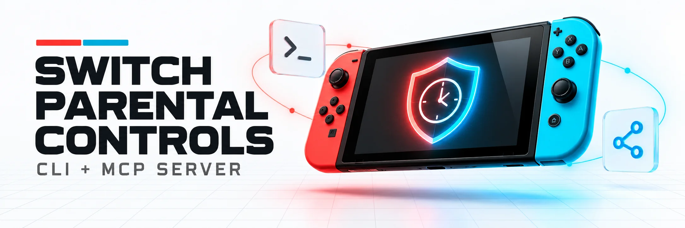

# Nintendo Switch Parental Controls

<picture>
  <source media="(prefers-color-scheme: dark)" srcset="https://raw.githubusercontent.com/udondan/switch-parental-controls/main/assets/banner-dark.webp">
  <source media="(prefers-color-scheme: light)" srcset="https://raw.githubusercontent.com/udondan/switch-parental-controls/main/assets/banner-light.webp">
  
</picture>

[](https://pypi.org/project/switch-parental-controls/)
[](https://hub.docker.com/r/udondan/switch-parental-controls)
[](https://pypi.org/project/switch-parental-controls/)
[](https://github.com/udondan/switch-parental-controls/actions/workflows/test.yml)
[](https://codecov.io/gh/udondan/switch-parental-controls)
[](LICENSE)

A [CLI](#cli-usage) and [MCP (Model Context Protocol)](https://modelcontextprotocol.io) server that expose Nintendo Switch Parental Controls as commands and AI-accessible tools. It wraps the [`pynintendoparental`](https://github.com/pantherale0/pynintendoparental) library and allows humans and AI assistants to monitor and manage parental control settings on Nintendo Switch devices.

## Table of Contents

- [Features](#features)
- [Prerequisites](#prerequisites)
- [CLI Usage](#cli-usage)
  - [Installation](#installation)
  - [Authentication](#authentication)
    - [Interactive login](#interactive-login)
    - [Storing your token](#storing-your-token)
  - [Docker](#docker)
  - [Global Options](#global-options)
  - [Commands](#commands)
- [Caching](#caching)
- [MCP Server](#mcp-server)
  - [Running the Server](#running-the-server)
  - [Environment Variables](#environment-variables)
  - [MCP Client Configuration](#mcp-client-configuration)
  - [Docker MCP Toolkit](#docker-mcp-toolkit)
  - [Available Tools](#available-tools)
- [Development](#development)
- [CI](#ci)
- [Legal](#legal)
- [License](#license)

## <a name="features"></a>Features

- **Authentication**: Interactive Nintendo OAuth login flow, or pre-configured session token
- **Device monitoring**: List devices, view playtime, remaining time, sync status
- **Playtime controls**: Set daily limits, add extra time, configure per-day-of-week schedules
- **Bedtime controls**: Set bedtime alarms and end times
- **Restriction controls**: Set restriction mode (forced termination vs. alarm), content restriction levels
- **Player tracking**: View player profiles and today's app usage
- **Application management**: List apps, manage the allow-list (bypass content restrictions)

## <a name="prerequisites"></a>Prerequisites

- [uv](https://docs.astral.sh/uv/) — install once, no Python or clone needed:

```bash
curl -LsSf https://astral.sh/uv/install.sh | sh
```

## <a name="cli-usage"></a>CLI Usage

The `switch-parental-controls` CLI gives you direct terminal access to all parental control features.

### <a name="installation"></a>Installation

No clone required — run directly with `uvx`:

```bash
uvx switch-parental-controls --help
```

Or install globally:

```bash
pip install switch-parental-controls
switch-parental-controls --help
```

The CLI and the MCP server are also available as the Docker image [`udondan/switch-parental-controls`](https://hub.docker.com/r/udondan/switch-parental-controls) (amd64 and arm64), no Python needed. See [Docker](#docker).

### <a name="authentication"></a>Authentication

#### <a name="interactive-login"></a>Interactive login

```bash
switch-parental-controls login
```

This starts an interactive flow:

1. A Nintendo login URL is printed — open it in your browser
2. Log in with your Nintendo Account
3. Right-click the **"Select this person"** button and copy the link
4. Paste the copied URL at the prompt

On success, the token is saved to `~/.config/switch-parental-controls/credentials` (respects `XDG_CONFIG_HOME`) — all other commands will use it automatically. No further setup needed.

The CLI also prints an `export SWITCH_PARENTAL_CONTROLS_SESSION_TOKEN=...` snippet after login, so you can copy the token value for use in other tools or scripts.

#### <a name="storing-your-token"></a>Storing your token

The token lookup order is: **environment variable → credentials file**.

**Credentials file (recommended):**

The `login` command writes the token here automatically. To store it manually:

```bash
mkdir -p "${XDG_CONFIG_HOME:-$HOME/.config}/switch-parental-controls"
echo "your-token-here" > "${XDG_CONFIG_HOME:-$HOME/.config}/switch-parental-controls/credentials"
chmod 600 "${XDG_CONFIG_HOME:-$HOME/.config}/switch-parental-controls/credentials"
```

The default path is `~/.config/switch-parental-controls/credentials`; set `XDG_CONFIG_HOME` to use a different base directory. The file must contain only the token, one line, no quotes. The `chmod 600` keeps it readable by your user only.

**Environment variable (shell profile):**

```bash
# Add to ~/.zshrc, ~/.bashrc, or equivalent
export SWITCH_PARENTAL_CONTROLS_SESSION_TOKEN="your-token-here"
```

The environment variable takes precedence over the credentials file, so this is also useful for temporarily overriding a stored token.

**Inline for one-off runs:**

```bash
SWITCH_PARENTAL_CONTROLS_SESSION_TOKEN="your-token-here" switch-parental-controls today-summary
```

> **Note**: Session tokens can expire. If you get authentication errors, repeat the login flow.

### <a name="docker"></a>Docker

The image stores the token and the caches in `/data`. Mount a volume there so they survive between runs. Log in once (`-it` for the interactive prompt):

```bash
docker run --rm -it -v switch-parental-controls:/data udondan/switch-parental-controls login
```

With the same volume, an alias makes the image behave like an installed `switch-parental-controls`. `-e NAME` without a value passes the variable from your shell, if set:

```bash
alias switch-parental-controls='docker run --rm -i -e SWITCH_PARENTAL_CONTROLS_TIMEZONE -e SWITCH_PARENTAL_CONTROLS_LANG -v switch-parental-controls:/data udondan/switch-parental-controls'

switch-parental-controls today-summary
```

Instead of the volume, the token can be passed as `-e SWITCH_PARENTAL_CONTROLS_SESSION_TOKEN`.

### <a name="global-options"></a>Global Options

```text
switch-parental-controls [OPTIONS] COMMAND [ARGS]...

Options:
  -t, --timezone TEXT   IANA timezone  [env: SWITCH_PARENTAL_CONTROLS_TIMEZONE; default: Europe/London]
  -l, --lang TEXT       Language code  [env: SWITCH_PARENTAL_CONTROLS_LANG; default: en-GB]
```

### <a name="commands"></a>Commands

All device commands accept an optional `[DEVICE]` argument — a device name or ID. If omitted and the account has exactly one Switch, it is auto-selected. Run `list-devices` once to populate the local cache.

**Device info:**

```bash
switch-parental-controls list-devices [--format markdown|json]
switch-parental-controls get-device [DEVICE] [--format markdown|json]
switch-parental-controls today-summary [DEVICE] [--format markdown|json]
switch-parental-controls monthly-summary [DEVICE] [--year YEAR --month MONTH] [--player PLAYER_ID] [--no-cache] [--format markdown|json]
switch-parental-controls playtime [DEVICE] [--year YEAR --month MONTH] [--day DAY] [--player PLAYER_ID] [--no-cache] [--format markdown|json]

# DEVICE may be a name or an ID
switch-parental-controls today-summary "Switch #1"
switch-parental-controls today-summary abc123def456
```

**Playtime limits:**

```bash
switch-parental-controls set-playtime-limit [DEVICE] --minutes 120   # set 2-hour limit
switch-parental-controls set-playtime-limit [DEVICE] --no-limit       # remove limit
switch-parental-controls add-extra-time [DEVICE] 30                   # add 30 extra minutes today
switch-parental-controls set-timer-mode [DEVICE] DAILY
switch-parental-controls set-timer-mode [DEVICE] EACH_DAY_OF_THE_WEEK
```

**Per-day restrictions:**

```bash
# Enable playtime + bedtime on Monday
switch-parental-controls set-day-restrictions [DEVICE] MONDAY \
  --playtime-enabled --max-playtime-minutes 90 \
  --bedtime-enabled \
  --bedtime-alarm-hour 21 --bedtime-alarm-minute 0 \
  --bedtime-end-hour 7 --bedtime-end-minute 0

# Disable all restrictions on Saturday
switch-parental-controls set-day-restrictions [DEVICE] SATURDAY \
  --playtime-disabled --bedtime-disabled
```

**Restriction and content controls:**

```bash
switch-parental-controls set-restriction-mode [DEVICE] FORCED_TERMINATION
switch-parental-controls set-restriction-mode [DEVICE] ALARM
switch-parental-controls set-content-restriction [DEVICE] CHILDREN
switch-parental-controls set-bedtime-alarm [DEVICE] 21 0    # 21:00
switch-parental-controls set-bedtime-alarm [DEVICE] 0 0     # disable
switch-parental-controls set-bedtime-end [DEVICE] 7 0       # 07:00
```

**Players and applications:**

```bash
switch-parental-controls list-players [DEVICE] [--format json]
switch-parental-controls get-player [DEVICE] <player-id>
switch-parental-controls list-applications [DEVICE]
switch-parental-controls set-app-allow-list [DEVICE] <app-id> --allow
switch-parental-controls set-app-allow-list [DEVICE] <app-id> --no-allow

# Per-player usage data — use --player to filter monthly-summary and playtime
switch-parental-controls monthly-summary [DEVICE] --year 2026 --month 4 --player <player-id>
switch-parental-controls playtime [DEVICE] --year 2026 --month 4 --player <player-id>
switch-parental-controls playtime [DEVICE] --player <player-id>   # current month

# Single-day playtime — use --day to get one specific date instead of the whole month
switch-parental-controls playtime [DEVICE] --year 2026 --month 5 --day 15
switch-parental-controls playtime [DEVICE] --year 2026 --month 5 --day 15 --player <player-id>
```

**Cache management:**

```bash
switch-parental-controls clear-cache                          # clear entire cache
switch-parental-controls clear-cache --device "Switch #1"    # clear for one device
switch-parental-controls clear-cache --year 2026             # clear all months of a year
switch-parental-controls clear-cache --year 2026 --month 4   # clear a specific month
```

**Start the MCP server:**

```bash
switch-parental-controls mcp
```

## <a name="caching"></a>Caching

`monthly-summary` and `playtime` cache their API responses locally so past months don't require a network round-trip on subsequent calls.

**What is cached:** Raw API responses for months where both `--year` and `--month` are provided explicitly and the month is not the current calendar month. Data for the current month — and requests without an explicit year/month — always fetch live from the Nintendo API.

**Cache location:** `~/.config/switch-parental-controls/cache/` (respects `XDG_CONFIG_HOME`), organised as `{device-id}/{YYYY}-{MM}.json`.

**Bypassing the cache:** Pass `--no-cache` to `monthly-summary` or `playtime` to skip both reading from and writing to the cache. Useful when data looks unexpectedly stale.

**Clearing the cache:** Use the `clear-cache` command (CLI) or `switch_clear_cache` tool (MCP) — see the command examples above.

## <a name="mcp-server"></a>MCP Server

### <a name="running-the-server"></a>Running the Server

```bash
uvx switch-parental-controls mcp
```

No clone or install required — `uvx` fetches the package from PyPI and runs it in an isolated environment.

### <a name="environment-variables"></a>Environment Variables

| Variable                                | Required | Default         | Description                             |
| --------------------------------------- | -------- | --------------- | --------------------------------------- |
| `SWITCH_PARENTAL_CONTROLS_SESSION_TOKEN` | Yes\*    | —               | Nintendo session token                  |
| `SWITCH_PARENTAL_CONTROLS_TIMEZONE`      | No       | `Europe/London` | IANA timezone (e.g. `America/New_York`) |
| `SWITCH_PARENTAL_CONTROLS_LANG`          | No       | `en-GB`         | Language code (e.g. `en-US`)            |

\*The token can also be provided via the credentials file (`~/.config/switch-parental-controls/credentials` by default; respects `XDG_CONFIG_HOME`). Since the CLI `login` command writes to that same file, running `switch-parental-controls login` once is sufficient — the MCP server will pick up the stored token automatically, no environment variable needed. The only exception where no token is needed upfront at all is when using the interactive `switch_get_login_url` / `switch_complete_login` tools to authenticate.

### <a name="mcp-client-configuration"></a>MCP Client Configuration

Add to your MCP client configuration (e.g. Claude Desktop `claude_desktop_config.json`):

```json
{
  "mcpServers": {
    "nintendo": {
      "command": "uvx",
      "args": ["switch-parental-controls", "mcp"],
      "env": {
        "SWITCH_PARENTAL_CONTROLS_SESSION_TOKEN": "your-token-here",
        "SWITCH_PARENTAL_CONTROLS_TIMEZONE": "America/New_York",
        "SWITCH_PARENTAL_CONTROLS_LANG": "en-US"
      }
    }
  }
}
```

With Docker instead of `uvx`, the entry looks like this. `-e NAME` without a value passes the variable from `env` to the container:

```json
{
  "mcpServers": {
    "nintendo": {
      "command": "docker",
      "args": [
        "run",
        "--rm",
        "-i",
        "-e",
        "SWITCH_PARENTAL_CONTROLS_SESSION_TOKEN",
        "-e",
        "SWITCH_PARENTAL_CONTROLS_TIMEZONE",
        "-e",
        "SWITCH_PARENTAL_CONTROLS_LANG",
        "udondan/switch-parental-controls"
      ],
      "env": {
        "SWITCH_PARENTAL_CONTROLS_SESSION_TOKEN": "your-token-here",
        "SWITCH_PARENTAL_CONTROLS_TIMEZONE": "America/New_York",
        "SWITCH_PARENTAL_CONTROLS_LANG": "en-US"
      }
    }
  }
}
```

To use the token saved by `login` instead (see [Docker](#docker)), replace the token's `-e` pair with `"-v", "switch-parental-controls:/data"`.

### <a name="docker-mcp-toolkit"></a>Docker MCP Toolkit

With the [Docker MCP Toolkit](https://docs.docker.com/ai/mcp-catalog-and-toolkit/toolkit/) in Docker Desktop, the server runs as a container behind the MCP Gateway. The gateway starts the container on demand and passes the tools on to the connected clients. The token is stored as a secret in Docker Desktop instead of in plain text in the client configuration.

Requires Docker Desktop with the MCP Toolkit enabled.

1. Download the server definition [`docker-mcp.yml`](docker-mcp.yml) and add it to a Toolkit profile. The Toolkit only reads such files from its catalogs directory:

   ```bash
   mkdir -p ~/.docker/mcp/catalogs
   curl -fsSL https://raw.githubusercontent.com/udondan/switch-parental-controls/main/docker-mcp.yml -o ~/.docker/mcp/catalogs/switch-parental-controls.yml
   # New profile:
   docker mcp profile create --name switch-parental-controls --id switch-parental-controls --server "file://$HOME/.docker/mcp/catalogs/switch-parental-controls.yml"
   # Or add it to an existing profile:
   docker mcp profile server add default --server "file://$HOME/.docker/mcp/catalogs/switch-parental-controls.yml"
   ```

2. Store the token as a secret (see [Authentication](#authentication) for how to get one):

   ```bash
   docker mcp secret set switch-parental-controls.session_token=your-token-here
   ```

3. Optionally set timezone and language. Without them, the defaults `Europe/London` and `en-GB` apply:

   ```bash
   docker mcp profile config switch-parental-controls --set switch-parental-controls.timezone=America/New_York --set switch-parental-controls.lang=en-US
   ```

4. Connect a client to the profile:

   ```bash
   docker mcp client connect claude-desktop --profile switch-parental-controls
   ```

   `docker mcp client connect --help` lists other clients such as `claude-code`, `cursor` or `vscode`. This also works in Docker Desktop under _MCP Toolkit_.

`docker mcp gateway run --profile switch-parental-controls --dry-run --verbose` checks the setup without starting a client. It should end with `switch-parental-controls: (20 tools)`.

### <a name="available-tools"></a>Available Tools

#### Authentication Tools

| Tool                    | Description                                                   |
| ----------------------- | ------------------------------------------------------------- |
| `switch_get_login_url`  | Generate the Nintendo login URL and step-by-step instructions |
| `switch_complete_login` | Complete login with the redirect URL from the browser         |

#### Devices

| Tool                          | Description                                                              |
| ----------------------------- | ------------------------------------------------------------------------ |
| `switch_list_devices`         | List all Nintendo Switch devices on the account                          |
| `switch_get_device`           | Get detailed status for a specific device                                |
| `switch_get_today_summary`    | Get today's usage summary for a device                                   |
| `switch_get_monthly_summary`  | Get monthly usage summary (optionally for a specific month)              |
| `switch_get_playtime`         | Get per-day playtime breakdown for a month (current month or historical) |
| `switch_clear_cache`          | Clear locally cached historic play data (all, by device, year, or month) |

#### Playtime Controls

| Tool                              | Description                                                |
| --------------------------------- | ---------------------------------------------------------- |
| `switch_set_daily_playtime_limit` | Set the daily playtime limit (0-360 min, or -1 to remove)  |
| `switch_add_extra_time`           | Add extra playtime for today                               |
| `switch_set_timer_mode`           | Switch between DAILY and EACH_DAY_OF_THE_WEEK modes        |
| `switch_set_day_restrictions`     | Set per-day playtime and bedtime restrictions              |

#### Restriction Controls

| Tool                                    | Description                              |
| --------------------------------------- | ---------------------------------------- |
| `switch_set_restriction_mode`           | Set FORCED_TERMINATION or ALARM mode     |
| `switch_set_content_restriction_level`  | Set age-based content restrictions       |
| `switch_set_bedtime_alarm`              | Set the bedtime alarm time (16:00-23:00) |
| `switch_set_bedtime_end_time`           | Set when bedtime ends (05:00-09:00)      |

#### Players

| Tool                  | Description                                    |
| --------------------- | ---------------------------------------------- |
| `switch_list_players` | List all players on a device                   |
| `switch_get_player`   | Get player details including apps played today |

#### Applications

| Tool                           | Description                                               |
| ------------------------------ | --------------------------------------------------------- |
| `switch_list_applications`     | List all tracked applications on a device                 |
| `switch_set_app_allow_list`    | Add/remove an app from the content restriction allow-list |

## <a name="development"></a>Development

Requires [mise](https://mise.jdx.dev/):

```bash
# Install dependencies
mise run install

# Run tests
mise run test

# Run linter
mise run lint

# Fix lint issues
mise run lint-fix

# Open MCP Inspector (browser UI to test tools interactively)
mise run inspect

# Build the Docker image
mise run docker-build

# Add the local image to a Docker MCP Toolkit profile (default: switch-parental-controls)
mise run docker-register [profile]

# Both of the above
mise run docker
```

The locally built `udondan/switch-parental-controls:latest` takes the place of the published image, so the Docker MCP Toolkit runs the local build. `docker pull udondan/switch-parental-controls` switches back.

### MCP Inspector

The `inspect` task launches the [MCP Inspector](https://github.com/modelcontextprotocol/inspector) — a browser-based UI for testing MCP tools interactively without needing a full AI client.

```bash
mise run inspect
```

This opens the inspector connected to the switch_parental_controls server. You can call any tool directly from the UI, which is useful for testing the authentication flow and verifying tool responses.

## <a name="ci"></a>CI

Tests run automatically on pull requests via GitHub Actions. See [`.github/workflows/test.yml`](.github/workflows/test.yml). The `docker` job builds the image and lists its tools through the Docker MCP Gateway.

Each release runs [`.github/workflows/publish.yml`](.github/workflows/publish.yml), which uploads the package to PyPI and pushes the signed image `udondan/switch-parental-controls` (amd64 and arm64, tags `x.y.z`, `x.y`, `x`, `latest`) to Docker Hub.

## <a name="legal"></a>Legal

Nintendo and Nintendo Switch are trademarks or registered trademarks of Nintendo in the U.S. and/or other countries.

This project is not affiliated, funded, or in any way associated with Nintendo.

## <a name="license"></a>License

MIT
